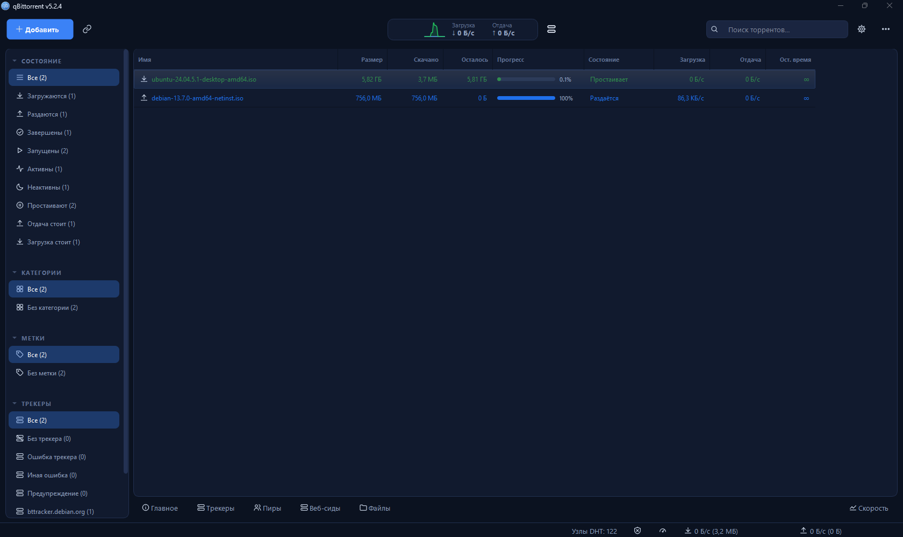

# qBittorrent — modern UI fork

Форк [qBittorrent](https://github.com/qbittorrent/qBittorrent) (ветка `release-5.2.4`) с переработанным интерфейсом.
Торрент-движок, сеть и настройки не тронуты, изменения только в `src/gui`.

## Что изменено

- Тёмно-синий стиль на базе Fusion: скруглённые кнопки, поля, меню, вкладки, списки, скроллбары; тёмный заголовок окна Windows 11.
- Монохромный набор иконок (84 SVG в стиле Lucide) вместо цветных стоковых — тулбар, боковая панель, статусы, вкладки свойств, статус-бар.
- Строки меню нет: все меню в кнопке «⋯» справа, горячие клавиши сохранены.
- Тулбар: акцентная кнопка «Добавить», ссылка, старт/стоп/удалить только при выделении, индикатор скорости с мини-графиками (клик — лимиты), поиск, настройки.
- Таблица торрентов по умолчанию: Имя, Размер, Скачано, Осталось, Прогресс (скруглённый бар с процентом), Состояние, Загрузка, Отдача, Ост. время. Остальные колонки — правым кликом по заголовку.
- Карточный режим (кнопка на панели): крупные строки с прогрессом, скоростями, ETA, рейтингом, сидами и пирами; сортировка в панели.
- Боковая панель: пустые статусы скрыты, ширина 230.
- Пустой список: подсказка вместо пустоты.
- Полный русский перевод, включая новые строки.

## Файлы

- `src/gui/modern/modernstyle.*` — палитра, QSS, шрифт, тёмный заголовок окна
- `src/gui/modern/transferlistcarddelegate.*` — карточки
- `src/gui/modern/speedindicator.*` — индикатор скорости
- `src/gui/modern/icons/` + `modern.qrc` — иконки
- правки: `mainwindow.*`, `transferlistwidget.*`, `transferlistdelegate.cpp`, `transferlistfilterswidget.cpp`, `properties/proptabbar.cpp`, `uithememanager.cpp`, `uithemesource.cpp`, `base/preferences.cpp`

## Сборка (Windows, MSVC)

Как в официальном CI (`.github/workflows/ci_windows.yaml`): Qt 6.10, Boost 1.91, libtorrent 2.0.15, OpenSSL/zlib через vcpkg (triplet `x64-windows-static-md-release`), CMake + Ninja.

---

qBittorrent - A BitTorrent client in Qt
------------------------------------------

********************************
### Description:
qBittorrent is a bittorrent client programmed in C++ / Qt that uses
libtorrent (sometimes called libtorrent-rasterbar) by Arvid Norberg.

It aims to be a good alternative to all other bittorrent clients
out there. qBittorrent is fast, stable and provides unicode
support as well as many features.

The free [IP to Country Lite database](https://db-ip.com/db/download/ip-to-country-lite) by [DB-IP](https://db-ip.com/) is used for resolving the countries of peers. The database is licensed under the [Creative Commons Attribution 4.0 International License](https://creativecommons.org/licenses/by/4.0/).

### Installation:

Refer to the [INSTALL](INSTALL) file.

### Public key:
Starting from v3.3.4 all source tarballs and binaries are signed. 
The key currently used is 4096R/[5B7CC9A2](https://pgp.mit.edu/pks/lookup?op=get&search=0x6E4A2D025B7CC9A2) with fingerprint `D8F3DA77AAC6741053599C136E4A2D025B7CC9A2`. 
You can also download it from [here](https://github.com/qbittorrent/qBittorrent/raw/master/5B7CC9A2.asc). 
**PREVIOUSLY** the following key was used to sign the v3.3.4 source tarballs and v3.3.4 Windows installer **only**: 4096R/[520EC6F6](https://pgp.mit.edu/pks/lookup?op=get&search=0xA1ACCAE4520EC6F6) with fingerprint `F4A5FD201B117B1C2AB590E2A1ACCAE4520EC6F6`. 

### Misc:
For more information please visit:
https://www.qbittorrent.org

or our wiki here:
https://wiki.qbittorrent.org

Use the forum for troubleshooting before reporting bugs:
https://forum.qbittorrent.org

Please report any bug (or feature request) to:
https://bugs.qbittorrent.org

Official IRC channel:
[#qbittorrent on irc.libera.chat](ircs://irc.libera.chat:6697/qbittorrent)

------------------------------------------
sledgehammer999 \<sledgehammer999@qbittorrent.org\>
